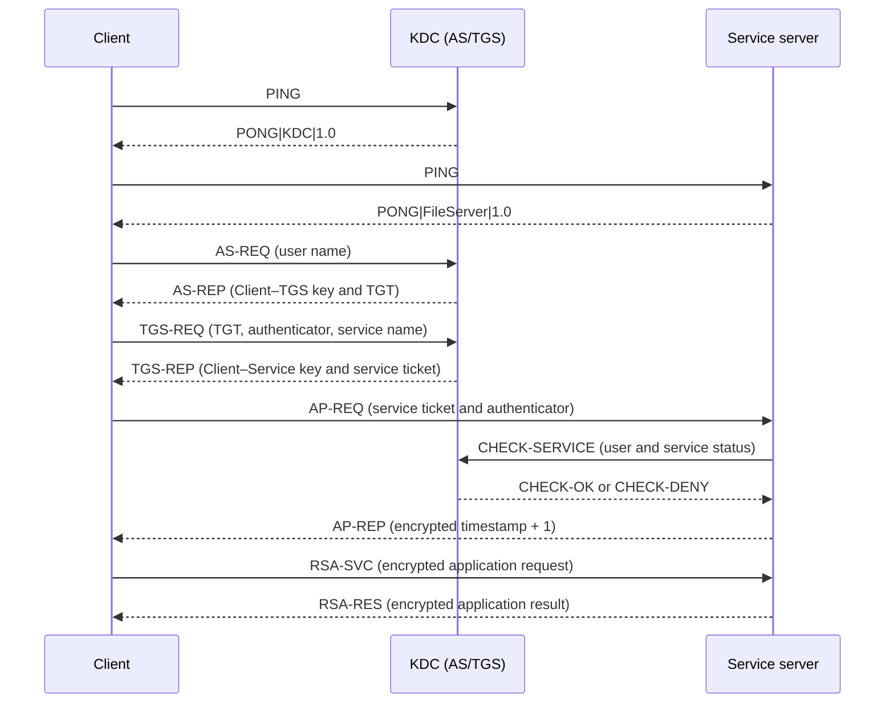

# Protocol and Operations Guide

## 1. Purpose and scope

Kerberos-Project is an educational Java application that demonstrates ticket-based authentication using three roles:

- **Client** — requests tickets and presents a service ticket to access a service.
- **Key Distribution Center (KDC)** — combines the Authentication Service (AS) and Ticket-Granting Service (TGS), maintains demo users and services, and issues tickets.
- **Service server** — validates service tickets and authenticators, then exposes a small RSA demonstration after authentication.

The exchanges resemble the Kerberos authentication flow, but the messages and cryptographic choices are custom to this project. The application is not an implementation of the Kerberos network protocol defined by an RFC, is not interoperable with Kerberos software, and should not be used as a security boundary.

## 2. Architecture and runtime

Each role is a separate Swing application. The client and service communicate with the KDC over TCP; the client also communicates directly with the service server. The default listening ports are `8888` (KDC) and `9999` (service). The client and service server initially use `localhost`; their host and port fields can be changed for a LAN demonstration.

Start the KDC and service server from their interfaces before connecting the client. The service server also needs the KDC running because it checks the user's and service's current status during AP authentication and before each RSA request. If that check cannot reach the KDC, the service denies the request.

The KDC keeps user accounts, locked-user state, service secrets, and ticket-table rows in memory. The service server keeps authenticated sessions, replay data, RSA key pairs, and request records in memory. Nothing is persisted across application restarts. The KDC's default TGT lifetime is 10 minutes and the service-ticket lifetime is 5 minutes; both can be adjusted in its interface.

## 3. Authentication sequence

The first two pings are optional connectivity checks and are not Kerberos protocol messages. The RSA exchange is a project-specific extension that becomes available after the client validates AP-REP.

### 3.1 AS exchange: obtain a Ticket-Granting Ticket

1. The client sends `AS-REQ|<user>` to the KDC. The request contains the user name, not the password.
2. If the account exists and is not locked, the KDC creates a random AES session key for the client and TGS and an expiry time.
3. The KDC returns `AS-REP|<encrypted-client-data>|<TGT>`. The client data contains the session key and expiry and is encrypted using a key derived from the user's password. The TGT contains the user, session key, and expiry and is encrypted using the KDC's fixed TGS key.
4. The client uses its password to derive the same key and decrypt the client data. A wrong password results in a decryption/authentication failure.

### 3.2 TGS exchange: obtain a service ticket

1. The client creates an authenticator containing its user name and current timestamp, encrypts it with the Client–TGS session key, and sends `TGS-REQ|<TGT>|<authenticator>|<service>`.
2. The KDC decrypts and checks the TGT, confirms that it has not expired, decrypts the authenticator, verifies that its user matches the TGT user, and checks the timestamp.
3. The KDC creates a Client–Service session key and service-ticket expiry. It returns `TGS-REP|<encrypted-client-data>|<service-ticket>`. The client data is protected with the Client–TGS session key. The service ticket, containing the user, Client–Service session key, expiry, and service name, is protected with the service secret.

The client currently requests the service name `FileServer` in its TGS request.

### 3.3 AP exchange: authenticate to the service

1. The client creates a fresh user-and-timestamp authenticator encrypted with the Client–Service session key. It sends `AP-REQ|<service-ticket>|<authenticator>` directly to the service server.
2. The server decrypts the service ticket using its configured service secret and checks the service name, expiry, authenticator user, timestamp, and replay set. It then asks the KDC whether the user is still enabled and the service still exists.
3. If all checks pass, the server stores an in-memory session and returns `AP-REP|<encrypted-timestamp-plus-one>`. The client decrypts the reply and compares it with the timestamp it sent. This demonstrates mutual authentication within this model.

## 4. Message and transport format

Application messages are UTF-8 text, one line per TCP connection. Fields are separated by the `|` character. Encrypted values are Base64 strings. Each request opens a socket, writes one line, reads one response line, and closes the connection. The client uses a three-second timeout for pings, five seconds for ticket exchanges, and ten seconds for RSA requests; the service's KDC status check uses a three-second timeout.

Principal message forms are:

| Message | Direction | Purpose |
|---|---|---|
| `PING` / `PONG` | Client → KDC or service / response | Connectivity and service identification (`PONG` includes version `1.0`). |
| `AS-REQ` / `AS-REP` | Client ↔ KDC | Request and receive client session data plus a TGT. |
| `TGS-REQ` / `TGS-REP` | Client ↔ KDC | Exchange a TGT and authenticator for a service ticket. |
| `AP-REQ` / `AP-REP` | Client ↔ service | Present a service ticket and authenticator; prove the server knows the session key. |
| `CHECK-SERVICE` | Service → KDC | Check whether a user remains unlocked and the service remains registered. |
| `RSA-SVC` / `RSA-RES` | Client ↔ service | Carry an authenticated, encrypted RSA operation and its response. |
| `ERR` / `RSA-ERR` | Server → client | Report an invalid or failed operation. |

## 5. Cryptographic operations

### 5.1 AES and key derivation

The project encrypts ticket data, authenticators, RSA requests, and RSA responses with `AES/GCM/NoPadding`. Each encryption uses a random 12-byte nonce and a 128-bit GCM authentication tag; the nonce is prepended to the ciphertext and tag before Base64 encoding. Session keys are generated as random 256-bit AES keys.

For the demonstration, a password-derived key is made by hashing the UTF-8 password once with SHA-256 and using the 32-byte digest as an AES key. This is not a password hashing or key-derivation scheme suitable for real credentials: it has no salt or work factor. The TGS key is derived the same way from the fixed source-code value `Kerberos-TGS-demo-key`. User and service secrets are demonstration values and are not protected by persistent secret storage.

### 5.2 RSA service extension

After AP-REP succeeds, the client can request `SINH_KHOA`, `MA_HOA`, or `GIAI_MA` for a 1024-bit or 2048-bit RSA key. RSA key generation and private-key operations occur in the service-server process. The server returns the public key in Base64 form to the client. RSA requests are AES-GCM protected with the Client–Service session key and include the user name, monotonically increasing sequence number, timestamp, operation, key size, and payload. The service checks the active session, expiry, timestamp, sequence number, and current KDC status before performing the operation.

The implementation uses `RSA/ECB/PKCS1Padding`. With PKCS#1 v1.5 encryption padding, the maximum plaintext length is the modulus length in bytes minus 11: 117 bytes for RSA-1024 and 245 bytes for RSA-2048. Ciphertexts are 128 and 256 bytes respectively, before Base64 encoding. This feature is an application demonstration, not part of the AS/TGS/AP ticket exchange. RSA-1024 and PKCS#1 v1.5 are included for educational comparison and are not recommended for new systems.

## 6. Validation and replay behavior

- TGT and service-ticket expiries are checked when the ticket is used.
- Authenticator timestamps must be within two minutes of the local system clock.
- The service server rejects an AP authenticator already seen during the current process lifetime.
- RSA requests must have a sequence number greater than the last accepted sequence for that in-memory user session.
- The AS checks that the account exists and is unlocked; the TGS checks that the requested service is registered. The service server rechecks current user/service status at AP and RSA time.

These controls are limited to this demo. The TGS does not maintain an authenticator replay cache, the service's AP replay set has no expiry or size limit, and all state is lost on restart. Clock checks assume the machines have reasonably synchronized clocks. The implementation does not include the full message formats, negotiation, key management, or operational safeguards of standard Kerberos.

## 7. Interface behavior

### KDC administration window

The KDC window starts and stops the listener, displays the bound address, and lets the operator add or update users, lock/unlock or remove users, and add services. It also exposes the TGT and service-ticket lifetime controls, a table of issued tickets, and an activity log. User credentials, lock status, service secrets, and ticket rows are held in memory.

### Service server window

The service window starts and stops the listener and configures the service name, service secret, port, and KDC address. Tabs show accepted service tickets, generated public-key summaries, RSA request results and timings, and the activity log. Private RSA keys are kept in the service process and are not displayed in the key table.

### Client window

The client window configures both endpoint addresses and offers ping, AS, TGS, AP, disconnect, and ticket-clearing controls. A separate RSA tab exposes key generation, encryption, decryption, and replay demonstrations. RSA controls are enabled after successful AP-REP validation. Ticket fields and activity messages are displayed in the interface for inspection.

The interfaces and logs are part of the demonstration and are not a durable audit trail. The GUI labels are currently in Vietnamese.

## 8. Known limitations

- This is a custom demonstration protocol, not standard Kerberos and not interoperable with a KDC or service using Kerberos.
- TCP traffic is not protected by TLS. Although selected message contents are encrypted, endpoint identities and protocol metadata are not protected as they would be in a production protocol.
- Demo passwords and service secrets are embedded as defaults; the TGS key is hard-coded. Password-to-key conversion is a single SHA-256 operation.
- Account, service, ticket, session, replay, and RSA key data are held in process memory and are not persisted.
- The TGS has no replay cache for its authenticators. The AP replay set is unbounded and lasts only until the service process exits.
- Client and service behavior is tailored to the single `FileServer` demonstration; there is no configurable client-side service selection.
- No automated test suite or recorded execution evidence is included in this repository. Do not describe a scenario as passed unless it has been run and supported with actual logs or screenshots.

## 9. Source map

| File | Responsibility |
|---|---|
| `ClientForm.java` | Client UI, endpoint pings, AS/TGS/AP requests, and RSA client operations. |
| `KDCAdminForm.java` | KDC listener, in-memory account and service administration, and AS/TGS handling. |
| `ServiceServerForm.java` | Service listener, AP checks, KDC status checks, and RSA operations. |
| `CryptoUtil.java` | AES-GCM encryption, session-key creation, and password-to-key helper. |
| `GiaoThuc.java` | Default ports, protocol version, field helpers, and timestamp validation. |
| `RsaUtil.java` | RSA key generation, size limits, encryption, and decryption. |
| `DemoLauncher.java` | Optional convenience launcher for the desktop forms. |

Gradle run tasks and startup instructions are documented in the [README](README.md).
