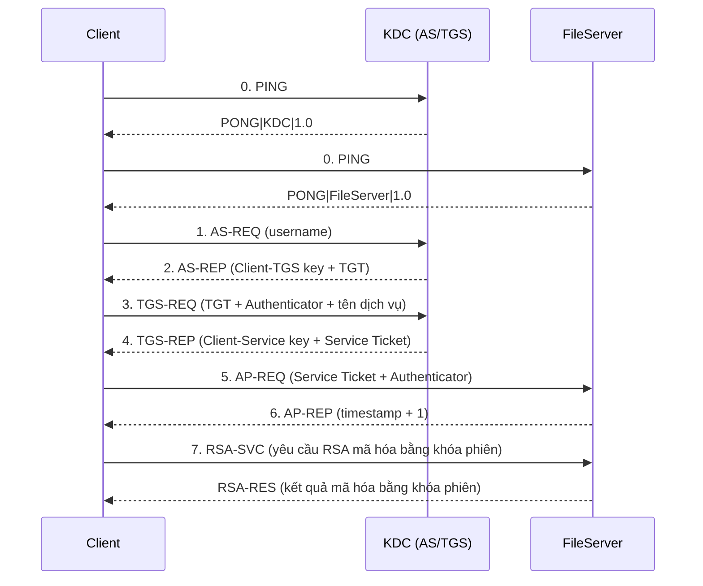

# Mô phỏng giao thức Kerberos bằng Java Swing

Đây là project học tập mô phỏng các vai trò Client, KDC (AS/TGS) và FileServer. Mã nguồn dùng Java 21, Swing, TCP Socket và các API mã hóa có sẵn trong JDK. Đây là mô hình minh họa, không phải cài đặt Kerberos chuẩn hoặc hệ thống triển khai an toàn.

## Cấu trúc

```text
src/main/java/org/ADuck/
  ClientForm.java       Client AS/TGS/AP và giao diện RSA
  KDCAdminForm.java     KDC, quản lý mẫu user/dịch vụ và phát ticket
  ServiceServerForm.java FileServer, xác thực AP và xử lý RSA
  CryptoUtil.java       AES-GCM, khóa mật khẩu, khóa phiên
  GiaoThuc.java         Hằng số, định dạng trường, timestamp
  RsaUtil.java          Sinh khóa, mã hóa/giải mã RSA
```

## Biên dịch và chạy

Trong IntelliJ chạy lần lượt `KDCAdminForm`, `ServiceServerForm`, `ClientForm`. Mỗi lớp có `main` riêng. Hoặc trong thư mục `src/main/java/org/ADuck/`:

```text
javac --release 21 *.java
java org.ADuck.KDCAdminForm
```

Để chạy từ thư mục chứa package, nên biên dịch ra thư mục gốc: `javac --release 21 -d out src/main/java/org/ADuck/*.java`, sau đó `java -cp out org.ADuck.KDCAdminForm` (tương tự với hai form còn lại). KDC mặc định cổng 8888, FileServer 9999. Client mặc định host `localhost`; khi máy khác cùng LAN chạy server, nhập IPv4 LAN hiển thị trên server và cổng tương ứng. Mở cổng firewall nếu cần.

Tài khoản mẫu: `an / 123456`, `binh / abc123`. Dịch vụ mẫu: `FileServer`, khóa `FileServer-demo-key`.

## Luồng giao thức



| Thông điệp | Người gửi → nhận | Nội dung chính |
|---|---|---|
| AS-REQ | Client → KDC | Tên user |
| AS-REP | KDC → Client | Khóa Client-TGS mã hóa bằng khóa mật khẩu; TGT mã hóa bằng khóa TGS |
| TGS-REQ | Client → KDC | TGT, Authenticator, dịch vụ |
| TGS-REP | KDC → Client | Khóa Client-Service và Service Ticket |
| AP-REQ | Client → FileServer | Service Ticket, Authenticator |
| AP-REP | FileServer → Client | Timestamp + 1 mã hóa với khóa phiên |

Các trường được ngăn bằng `|`; nội dung mật mã hóa AES-GCM có dạng Base64. Mỗi yêu cầu TCP hiện tại mở một socket, gửi một dòng và đọc một dòng phản hồi.

## Lệnh RSA

| Lệnh | Hoạt động | Giới hạn/đầu ra |
|---|---|---|
| SINH_KHOA | Server sinh cặp RSA 1024/2048 theo client | Trả public key Base64; private key ở server |
| MA_HOA | Mã hóa một chuỗi với public key | Tối đa 117 byte (1024) hoặc 245 byte (2048) |
| GIAI_MA | Giải mã bằng private key cùng cỡ | Bản mã lần lượt dài 128 hoặc 256 byte |

Trong bản hiện tại, RSA được mở trên client sau AP-REP. Mã hóa dịch vụ dùng RSA/ECB/PKCS1Padding để minh họa theo yêu cầu; không dùng cho triển khai mới.

## Kịch bản demo

| Ca | Thao tác | Kết quả dự kiến / trạng thái code |
|---|---|---|
| (a) | Bật KDC và FileServer, PING rồi chạy AS → TGS → AP | Đường đi thành công có trong code |
| (b) | Nhập sai mật khẩu | AS-REP không giải mã được; log lỗi client |
| (c) | Chỉnh thời hạn thật ngắn, đợi ticket quá hạn | KDC/Server có kiểm tra hạn; form KDC có spinner phút |
| (d) | Gửi lại Authenticator AP cũ | Server từ chối trùng timestamp/user |
| (e) | Khóa user trên KDC rồi gọi RSA | CHECK-SERVICE từ chối yêu cầu RSA kế tiếp |
| (f) | Chưa AP, thử RSA | Các nút RSA bị khóa và có nhãn yêu cầu AP |
| (g) | RSA 1024, mã hóa/giải mã “Xin chao Kerberos” | RSA được xử lý bởi Service Server |
| (h) | Sinh khóa 2048 và gửi chuỗi dài phù hợp | So sánh log thật; thời gian không có số liệu định trước |
| (i) | Vượt 117/245 byte | Server trả lỗi giới hạn rõ ràng |
| (j) | Bấm Replay RSA | Cùng dòng/sequence bị từ chối |
| (k) | Giải mã bằng cỡ khóa không khớp | Lỗi giải mã được trả về client |
| (l) | KDC chưa bật, PING KDC | Nhãn lỗi đỏ; AS tắt |
| (m) | Bật KDC, PING rồi AS | PONG và AS khả dụng |
| (n) | Nhập sai cổng dịch vụ | Lỗi kết nối; AP tắt |
| (o) | Tắt server giữa yêu cầu RSA, bật lại | Client bắt lỗi; cần PING và AP lại |
| (p) | Dùng IP LAN từ máy khác | Hỗ trợ theo host/port nhập; cần kiểm tra thực tế mạng/firewall |

Không có ảnh chụp hoặc log chạy giao diện trong repo tại thời điểm tạo tài liệu; kết quả cần được chụp trong lần demo thật.
# Kerberos-Project
